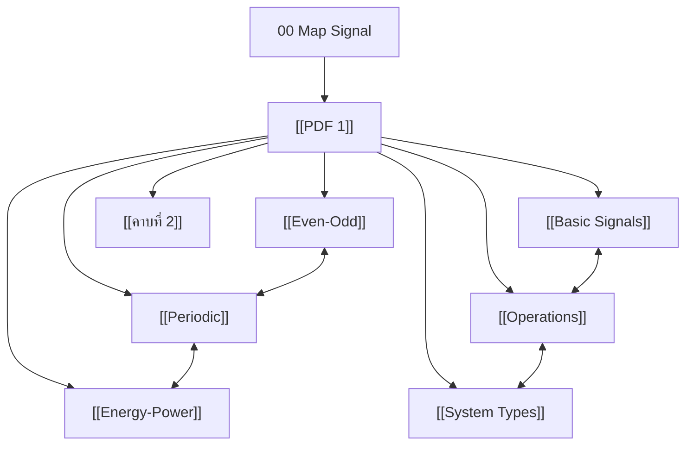

# 🗺️ Map — Signal Chapter 1

> ศูนย์กลางโยงทุกเรื่องใน `Signal/` — เปิด `Graph view` แล้วจะเห็นเส้นโยงออกไป

## เส้นหลัก
- [[PDF 1]] — สรุปใหญ่ Chapter 1
- [[คาบที่ 2]] — โน้ตในห้องเรียน

## เส้นย่อย (แตกหัวข้อให้กราฟแน่น)
- [[Even-Odd]] — คู่/คี่ + แยกส่วน
- [[Periodic]] — คาบ CT/DT + ตัวอย่าง 1.4/1.8-1.13
- [[Energy-Power]] — E/P + ตัวอย่าง 1.5-1.7
- [[Basic Signals]] — u/δ/r/sin/exp + sifting
- [[Operations]] — shift/scale/x(at+b)/ประตู u-r
- [[System Types]] — Memory/Causal/BIBO/T-Invariant/Linear

---
*วิธีดูเส้น: `Ctrl+G` (Graph) / โน้ตนี้ `...` → Open local graph*
