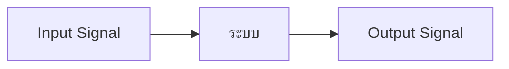
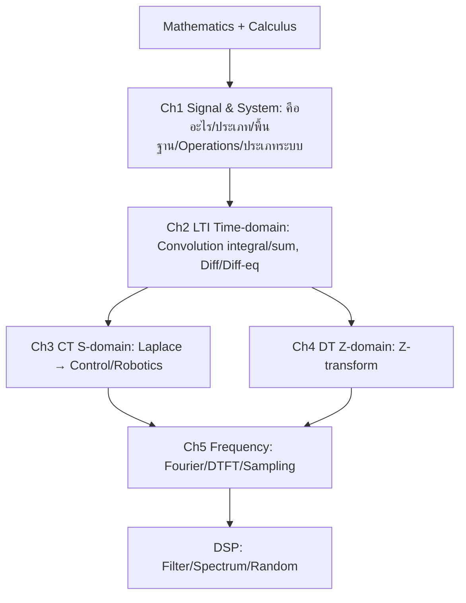

# Chapter 1 — สัญญาณและระบบขั้นแนะนำ

> `Input Signal → [ระบบ] → Output Signal` | สัญญาณ = สื่อของข่าวสาร | ระบบ = เครื่องมือจัดการสัญญาณ

---

## สารบัญ

- [[#1 สัญญาณคืออะไร|1 สัญญาณ]]
- [[#2 ระบบคืออะไร|2 ระบบ]]
- [[#3 วงจรไฟฟ้าเกี่ยวอะไร|3 วงจรไฟฟ้า]]
- [[#4 ต้นไม้ความรู้ของวิชานี้|4 ต้นไม้ความรู้]]
- [[#5 ประเภทสัญญาณ 5 กลุ่ม|5 ประเภทสัญญาณ]]
- [[#6 สัญญาณพื้นฐาน 6 ตัว|6 สัญญาณพื้นฐาน]]
- [[#7 ตัวดำเนินการกับสัญญาณ|7 Operations]]
- [[#8 การอธิบายระบบ + ประเภทของระบบ|8 ระบบ]]
- [[#9 สูตรลัดสอบ + กับดัก|9 สูตรสอบ]]

---

## 1 สัญญาณคืออะไร

> [!summary] นิยามท่องสอบ
> **สัญญาณคือฟังก์ชันของตัวแปรอิสระ (เช่น เวลา) ที่มีข่าวสาร (Information) บรรจุอยู่ภายใน**

- Ex: เสียงพูด = ข้อความผู้พูด, โทรศัพท์ = บทสนทนา, ไฟจราจร = สถานะช่องทาง, ECG = สภาวะหัวใจ
- Ex รูป: Digital `1 000 110 10 1000` (+5V/-5V), PSK (เฟสชิฟต์), เสียง 1 มิติ, Realtime MRI 4 มิติ

**คุณสมบัติร่วม 2 ข้อ:**
1. มี Information ข้างใน — สำคัญสุดคือข่าวสาร ไม่ใช่รูปคลื่น
2. เป็นฟังก์ชันของตัวแปรอิสระ — ปกติคือ `เวลา` แต่เป็นระยะทาง/พิกัด/ความถี่ก็ได้ มีได้หลายมิติ

| สัญญาณ | เป็นฟังก์ชันอะไร vs เวลา |
|---|---|
| เสียง | ความดันอากาศ |
| ไฟฟ้าทั่วไป | V / I |
| วิทยุ | สนามแม่เหล็กไฟฟ้า |
| แผ่นดินไหว | การสั่นของดิน |
| ไฟจราจร | สถานะหลอดไฟ |

**เราทำอะไรกับสัญญาณ 3 อย่าง:**
1. **บรรจุข่าวสารลงไป** — ส่ง/บันทึก เช่น TV → คลื่นแม่เหล็กไฟฟ้าออกอากาศ
2. **ดึงข่าวสารออกมาใช้** — เช่น fiber → digital, โทรศัพท์ → เสียง
3. **ปรับปรุงให้เหมาะกับงาน** — ขยาย, ตัด noise, แยกสัญญาณ, เข้า/ถอดรหัส

---

## 2 ระบบคืออะไร

> [!summary] นิยามท่องสอบ
> **ระบบคือสิ่งที่รับ Input signal → จัดการ/ประมวลผล → ส่ง Output signal**

| ตัวอย่าง | Input | Output | วัตถุประสงค์ |
|---|---|---|---|
| วิทยุผ่านบรรยากาศ | เสียง/ภาพ/digital | แบบเดียวกับ In | ส่งต้นทาง→ปลายทาง |
| รดน้ำผักอัตโนมัติ | ความชื้นดิน | น้ำรดผัก | คุมความชื้นตามที่ตั้ง |
| สำรวจน้ำมัน | Shock wave ระเบิด | คลื่นสะท้อน | ดูชั้นหินใต้ดิน |

---

## 3 วงจรไฟฟ้าเกี่ยวอะไร

- วงจรไฟฟ้า = อุปกรณ์หลักที่ใช้ **สร้างระบบ** (ไฟฟ้า/อิเล็กฯ, เชิงกล, ควบคุม ล้วนมีวงจรเป็นส่วนประกอบ)
- ที่มาวิชา = **Circuits + Signals + Systems**

---

## 4 ต้นไม้ความรู้ของวิชานี้

- Ch1 → Ch2: `ประเภทของระบบ → LTI`
- Ch2 → Ch3/Ch4: `สมการอนุพันธ์ → Laplace`, `สมการผลต่าง → Z`
- Ch3/Ch4 → Ch5 → DSP

---

## 5 ประเภทสัญญาณ 5 กลุ่ม

> 1. CT vs DT / 2. Even/Odd / 3. Periodic / 4. Energy/Power / 5. Deterministic/Random

---

### 5.1 CT vs DT + Notation

|  | CT (Continuous-time / Analog) | DT (Discrete-time) |
|---|---|---|
| นิยาม | มีค่าทุกเวลา กราฟต่อเนื่อง | มีค่าเฉพาะบางเวลา กราฟแท่ง/จุด |
| ตัวแปร | `t` จำนวนจริง | `n` จำนวนเต็ม หน่วย Sample |
| เขียน | `x(t), y(t)` | `x(n), y(n)` |
| Ex | ECG, เสียง, ไฟ 220V 50Hz | เสียงลง CD |
| วิชานี้ | — | สนเฉพาะระยะห่างเท่ากัน Equal Space |

> [!warning] Notation ห้ามพลาด
> - ตัวแปรอิสระคือ `t, n` ไม่ใช่ `x, y` แบบ Calculus (`f(x)` → ที่นี่คือ `x(t)`)
> - ห้ามเขียน `x` โดดๆ ต้อง `x(t)/x(n)`
> - `x(t)` = x เป็นฟังก์ชันของ t **ไม่ใช่ x คูณ t**
> - `x(t+2)` = สัญญาณ x ณ เวลา `t+2`

---

### 5.2 Even / Odd

|  | Even (คู่) | Odd (คี่) |
|---|---|---|
| ความหมาย | สมมาตรแกนตั้ง กระจกเงา | ปฏิสมมาตร สะท้อนเงาในน้ำ |
| CT | `x(-t) = x(t)` | `x(-t) = -x(t)` |
| DT | `x(-n) = x(n)` | `x(-n) = -x(n)` |
| Ex | `cos t, t^2` | `sin t, t^3, t` |
| กราฟเช็ค | `x(-1)=x(1)=0.75`, `x(-2)=x(2)=0` | `x(1)=0.9, x(-1)=-0.9`, `x(2)=-0.5, x(-2)=0.5` |

**แยกส่วน (ทุกสัญญาณ = คู่ + คี่):**
- `x(t) = xe(t) + xo(t)`
- `xe = [x(t)+x(-t)]/2`, `xo = [x(t)-x(-t)]/2`
- DT เปลี่ยน `t→n` เหมือนกัน
- พิสูจน์ในสไลด์ใช้ `xe(-t)=xe(t)`, `xo(-t)=-xo(t)` แทนกลับแล้วตัดกันเหลือ `2xe/2`, `2xo/2`

> [!note] วิธีลัด (ใช้ได้เฉพาะคูณ/หาร ห้ามบวก/ลบ)
> - even×even = even / odd×odd = even / even×odd = odd
> - เหมือน +×+ = +, -×- = +, +×- = -
> - จำแม่: `t→Odd, sin→Odd, cos→Even`

> [!example] ตัวอย่าง 1.1 (วิธีตรง) / 1.2 (วิธีลัด)
> `x(t) = t sin t + sin t cos t + t² sin t + cos² t`
> - `t·sin = Odd·Odd = Even`
> - `sin·cos = Odd·Even = Odd`
> - `t·t·sin = Odd·Even = Even → ×Odd = Odd`
> - `cos·cos = Even·Even = Even`
> - ✅ `xe = t sin t + cos² t` / `xo = sin t cos t + t² sin t`

---

### 5.3 Periodic / Non-periodic

**CT:** `x(t) = x(t+T)`, `f = 1/T`, `ω = 2π/T = 2πf`
- `T` หน่วยเวลา (วินาที → `f` หน่วย Hz = รอบ/วินาที)
- Ex: `Acos(ω0 t+φ)` มี `T = 2π/ω0` พิสูจน์โดย `cos(θ+2π)=cos θ`
- Ex: `sin(4πt)` → `ω0=4π, T=0.5`

**DT:** `x(n) = x(n+N)`, `F = 1/N`
- `N` หน่วย Sample **ต้องเป็นจำนวนเต็มเท่านั้น**
- `F` หน่วย รอบ/Sample

> [!warning] กับดัก DT — ห้ามใช้ `T=2π/ω0`
> ต้องหา N เต็มเล็กสุดจาก `sin θ = sin(θ+2πk)`

> [!example] ตัวอย่าง 1.4 (ตัวออกสอบบ่อย)
> `x(n) = sin(3π/8 n)`
> - `sin(3π/8 n) = sin(3π/8 n + 2πk) = sin(3π/8 (n + 16/3 k))`
> - ต้องการ `x(n)=x(n+N)` → `N = 16/3 k`, `k` จำนวนเต็มใดก็ได้
> - `k=1,2` ได้ N ไม่เต็ม, `k=6` ได้ 32 ไม่เล็กสุด → เลือก `k=3` ได้ **N=16**
> - กราฟ stem คาบ 16
>
> เทียบ CT `x(t)=sin(3π/8 t)` → `T = 2π/(3π/8) = 16/3` **คนละค่า!**

**Sinusoidal DT เป็นคาบก็ต่อเมื่อ:** `W0 = 2πk/N`

| ตัวอย่าง | W0 | จัดรูป | สรุป |
|---|---|---|---|
| 1.8 `Acos(3π/8 n+φ)` | `3π/8` | `=2π·3/16` | Periodic N=16 |
| 1.9 `cos(2n)` | `2` | จัดเป็น `2πk/N` ไม่ได้ | **ไม่เป็นคาบ** (ดูเหมือนคาบ 22 แต่ `x(0)≠x(22)≠x(44)`, มีตาราง 0–49 ประกอบ) |
| 1.10 `cos(2t)` CT | `ω0=2` | `T=2π/2=π` | CT sinusoid เป็น Periodic เสมอ |

**หลายความถี่บวกกัน → ค.ร.น.:**
- 1.11 `Asin(3π/8 n)cos(π/8 n)` ใช้ `sinθcosφ = ½[sin(θ-φ)+sin(θ+φ)]` ได้ `sin(π/4 n)+sin(π/2 n)` → N=8,4 → LCM=8
- 1.12 `sin(3π/4 n)+sin(π/3 n)` → `Ω0=3π/4=2π·3/8 (N=8)`, `π/3=2π·1/6 (N=6)` → LCM **24**
- 1.13 CT `sin(π/2 t)+sin(π/3 t)` → `T=4,6` → LCM **12**

---

### 5.4 Energy / Power

จากวงจร R: `E = ∫R·i² = ∫v²/R`, `P = R·i² = v²/R`, `P = dE/dt`, `E = ∫Pdt`

ให้ R=1 ได้สูตรสัญญาณทั่วไป:

|  | Energy (E) | Power (P) |
|---|---|---|
| CT | `E = ∫ x²(t) dt (-∞..∞)` | `P = lim 1/T ∫ x²(t) dt (-T/2..T/2)` |
| DT | `E = Σ x²(n)` | `P = lim 1/(2N+1) Σ x²(n)` |

- **Energy:** `0 < E < ∞` / **Power:** `0 < P < ∞`

> [!example] ตัวอย่างคำนวณ
> - **1.5** `x(t)=e^-t, t≥0` → `E = ∫₀^∞ e^-2t = 1/2` → Energy
> - **1.6** `x(n)=(1/2)^n, n≥0` → `E = Σ(1/4)^n = 1/(1-1/4) = 4/3` (อนุกรมเรขา `Σa^n = 1/(1-a)`) → Energy
> - **1.7** `x(n)=2, n≥0` → `E = Σ4 = ∞`, `P = lim 4(N+1)/(2N+1) = ∞` → **ไม่เป็นทั้งคู่**

> [!summary] ท่องสอบ 3 บรรทัด
> - **Periodic เป็น Power เสมอ:** CT `P = 1/T∫_T x²`, DT `P = 1/N Σ x²`
> - **Energy ไม่มีทางเป็น Power:** เอา E=C ไปหา P ได้ `P = C/T → 0`
> - **Power ไม่มีทางเป็น Energy:** เอา P=C ไปหา E ได้ `E = C·T → ∞`

---

### 5.5 Deterministic / Random

|  | Deterministic (กำหนดค่าได้) | Random (สุ่ม) |
|---|---|---|
| นิยาม | รู้ค่าทุกเวลา คำนวณได้เลย | ทำนายไม่ได้ มีความไม่แน่นอน |
| Ex | `sin(2πt), (0.5)^n` | Noise, ECG, เสียงพูด, แผ่นดินไหว |

---

## 6 สัญญาณพื้นฐาน 6 ตัว (Building Block)

> สัญญาณง่าย รูป/สูตรไม่ซับซ้อน เอาไว้ประกอบเป็นสัญญาณซับซ้อน

| # | ชื่อ | CT | DT | จำรูป |
|---|---|---|---|---|
| 1 | Unit Step `u` (ขั้นบันได) | `1 t≥0 else 0` | `1 n≥0 else 0` | ขั้นเดียว |
| 2 | Unit Impulse `δ` (เสา) | `0 t≠0, ∫δ=1` (กว้าง 0 สูง ∞ พื้นที่ 1, ลูกศร) | `1 n=0 else 0` (เสาสูง 1) | เสาต้นเดียว |
| 3 | Unit Ramp `r` (พื้นเอียง) | `t t≥0` | `n n≥0` | เส้นเอียง |
| 4 | Sinusoidal | `Acos(ω0 t+φ)` | `Acos(W0 n+φ)` | cos/sin |
| 5 | Exponential | `Ae^bt` | `Ar^n` | ขึ้น/ลง |
| 6 | Complex Exp | `Ae^(α+jβ)t` | `Ar^n, r=a+jb` | Euler |

---

### 6.1 Impulse เจาะลึก (ออกสอบ + ใช้บท 2)

- คิดภาพ `δ(t) = lim p(t)` เมื่อ `p` กว้าง `Δt` สูง `1/Δt` พื้นที่ 1 เสมอ → บีบกว้าง→0 สูง→∞
- **Sifting (กรอง):** `x(t)·δ(t) = x(0)·δ(t)` เพราะ δ เป็น 0 ที่อื่น
- `∫ x(t)δ(t) = x(0)`, เลื่อนไป `t0`: `∫ x(t)δ(t-t0) = x(t0)` — ดึงค่า x ณ `t0` ออกมา
- ใช้มากใน **Convolution บท 2**

**สัมพันธ์ δ ↔ u ↔ r:**
- `u(t) = ∫₋∞^t δ(τ)dτ` (t<0 ได้ 0 เพราะไม่คลุม 0, t≥0 ได้ 1)
- `δ(t) = du/dt` (slope u: <0 =0, >0 =0, =0 =∞ ตรงนิยาม δ)
- `u(t) = dr/dt`, `r(t) = ∫₋∞^t u(τ)dτ` (slope r = u)

---

### 6.2 Sinusoidal เจาะลึก

**CT:** `x(t) = A cos(ω0 t + φ)`
- `A` Amplitude, `ω0` Angular Freq [rad/s], `φ` Phase [rad]
- `T = 2π/ω0`, `f = 1/T`, `ω0 = 2πf` — **เป็น Periodic เสมอ**

**DT:** `x(n) = A cos(W0 n + φ)`
- `W0` [rad/Sample], คาบ `N`, `F = 1/N`
- **เป็นคาบก็ต่อเมื่อ `W0 = 2πk/N`** (พิสูจน์โดยแทนแล้วได้ `cos(θ+2πk)`)
- เอกลักษณ์ตรีโกณต้องได้: `sinθcosφ`, `cos(A±B)`, ดูสไลด์หน้าตาราง trig

---

### 6.3 Exponential เจาะลึก

- **CT `Ae^bt`:** `b<0` ลด (`e^-t`), `b>0` เพิ่ม
- **DT `Ar^n`:**
  - `0<r<1` (เช่น 0.8) ลด / `r>1` (1.25) เพิ่ม
  - `-1<r<0` (-0.8) ลดแบบสลับ +− / `r<-1` (-1.25) เพิ่มแบบสลับ +−
- เจอบ่อยในไฟฟ้า/เครื่องกล/เคมี/อุตสาหกรรม
- **Complex:** CT `Ae^(α+jβ)t = Ae^αt(cos βt + j sin βt)` (Euler `e^jθ = cosθ + j sinθ`), DT `r = a+jb = |r|e^jφ`, `|r|=√(a²+b²)`, `φ=arctan(b/a)`

---

## 7 ตัวดำเนินการกับสัญญาณ (Operations)

> 2 กลุ่ม: (1) กระทำกับ**ค่าของสัญญาณ** = Range (2) กระทำกับ**ตัวแปรเวลา** = Domain

---

### 7.1 กระทำกับค่า (จุดต่อจุด)

- **บวก:** `y(t) = x1(t)+x2(t)` / `y(n)=x1(n)+x2(n)` — รวมกราฟจุดต่อจุดทั้ง CT/DT
- **ลบ:** `y = x1 - x2` — ลบจุดต่อจุด (มีรูป DT ตัวอย่าง 1,2,3,4,6)
- คูณ/หารก็จุดต่อจุด (ใช้แยก even/odd)

---

### 7.2 กระทำกับเวลา

#### (a) Time Shifting (เลื่อนแกนเวลา)

- `y(t) = x(t - t0)`: `t0>0` เลื่อนขวา = **Delay** (หน่วงให้เกิดภายหลัง), `t0<0` เลื่อนซ้าย = **Advance** (เกิดก่อน)
- Ex: `x(t-2)` เลื่อนขวา 2, `x(t+1)` เลื่อนซ้าย 1

#### (b) Time Reversal (กลับเวลา)

- `y(t) = x(-t)` พลิกซ้าย-ขวา ใช้หา even/odd

#### (c) Time Scaling (ปรับสเกล)

- `y(t) = x(at)`:
  - `|a|>1` บีบ (เร็วขึ้น), `|a|<1` ยืด (ช้าลง), `a<0` พลิก+บีบ/ยืด
- **DT `y(n)=x(2n)` คือ Downsampling:** เอาเฉพาะ `n = …, -2,0,2,4,6,…` มาเรียงใหม่ จุดลดครึ่งหนึ่ง
  - ตาราง: `y(0)=x(0), y(1)=x(2), y(2)=x(4)`

#### (d) รวมร่าง `x(at + b)` — กับดักข้อสอบ (ตัวอย่าง 1.18)

แปลง `x(t) → x(2t-1)` มี 2 วิธีคิด:

- **วิธี 1 (Shift ก่อน):** `x(t) → Shift: x(t-1) → Scale: x(2t-1)` (แทน t ด้วย `t-0.5` หลัง scale? ระวัง)
- **วิธี 2 (Scale ก่อน — แนะนำ):** `x(t) → Scale_by_2: x(2t) → Delay_by_0.5: x(2(t-0.5)) = x(2t-1)`
  - ทำ Time Shift ให้แทน `t` ด้วย `t-0.5`
- จำ: ดึงตัวคูณออกก่อน `x(2t-1) = x(2(t-0.5))` แล้วค่อยเลื่อน 0.5

---

### 7.3 เขียนกราฟด้วย u และ r (ตัวอย่าง 1.15)

เทคนิค: ตัดเป็น Part A (สี่เหลี่ยม) + Part B (สามเหลี่ยม) แล้วใช้ประตู `[u(a)-u(b)]`

- Part A: `u(t) - u(t-1)` (พัลส์ 0–1)
- Part B: `(u(t-1)-u(t-3)) - r(t-1)·(u(t-1)-u(t-3))` = `(1-r(t-1))·(u(t-1)-u(t-3))`
- รวม: `x(t) = [u(t)-u(t-1)] + (1-r(t-1))·[u(t-1)-u(t-3)]`
- อีกโจทย์ลายมือ อ.: `x(t) = u(t)-u(t-1) + (1-r(t-1))(u(t-1)-u(t-2))` (เหลี่ยม 0–1 + ลาดลง 1–2)

> [!note] สูตรประตู
> - พัลส์ `a–b` สูง 1 = `u(t-a) - u(t-b)`
> - ลาดในช่วง `a–b` = `r(t-a)·[u(t-a)-u(t-b)]`

---

## 8 การอธิบายระบบ + ประเภทของระบบ

> ใช้ตัวดำเนินการจัดการสัญญาณ → เอามาประกอบกันเป็นระบบ → ใช้ตัวดำเนินการอธิบายระบบได้

### 8.1 รายการประเภท (ต้องเช็คทุกตัวก่อนไปบท LTI)

1. มีความจำ (Memory / Memoryless)
2. เป็นเหตุเป็นผล (Causal / Noncausal)
3. เสถียรภาพ (BIBO Stable)
4. เวลายืนยง (Time Invariant / Variant)
5. เชิงเส้น (Linear / Nonlinear) → รวมเป็น **LTI** ในบท 2

---

### 8.2 Memory (ตัวอย่าง 1.22 / 1.42)

- **Memoryless:** `y` ณ ปัจจุบันขึ้นกับ `x` ปัจจุบันเท่านั้น
- **มี Memory:** ขึ้นกับอดีต/อนาคตด้วย
- Ex 1.22: `y(n) = ⅓[x(n)+x(n-1)+x(n-2)]` → มี Memory (ใช้ `x(n-1),x(n-2)` อดีต)
- Ex 1.42 (ดูรูป): `x(t)` เริ่ม 0 จบ 1 แต่ `y(t)` เริ่ม 0 จบ 2 → จบไม่ตรงกัน → **มี Memory**
  - ถ้าเริ่ม-จบตรงกันหมด → Memoryless

---

### 8.3 Causal (ตัวอย่าง 1.27)

- **Causal:** `y` ปัจจุบันขึ้นกับแค่ปัจจุบัน+อดีต ไม่ขึ้นกับอนาคต (สร้างจริงได้)
- Ex 1.27 Accumulator: `y(n) = y(n-1) + x(n)` → Causal (มีแค่ `y(n-1)` อดีต + `x(n)` ปัจจุบัน)

---

### 8.4 BIBO Stable (ตัวอย่าง 1.32)

- **BIBO:** Input bounded → Output bounded (`0<max|x|<∞ → 0<max|y|<∞ ∀n`)
- Ex 1.32 ต่อจาก 1.22: `max|y| ≤ ⅓(Mx+Mx+Mx) = Mx` → **BIBO Stable**

---

### 8.5 Time Invariant (ตัวอย่าง 1.39 + รูป)

- **T-Invariant:** Input shift `t0` แล้ว Output shift `t0` เท่าเดิม
- วิธีพิสูจน์ 3 ขั้น:
  1. ให้ In เป็น `x(n-n0)` → ได้ `y1(n) = x(2n-n0)`
  2. เอา `n-n0` แทน `n` ทุกตัวในสมการเดิม → `y(n-n0) = x(2(n-n0)) = x(2n-2n0)`
  3. เทียบ `y1 ?= y(n-n0)` — ไม่เท่า → **Time Variant**
- Ex 1.39: `y(n)=x(2n)` (คูณเฉพาะตัวแปร `n` ด้วย 2) → `x(2n-n0) ≠ x(2n-2n0)` → Variant
- รูปจำ: `x(t)` (0–1) → `y(t)` (0–2), พอเลื่อน In เป็น `x(t-1)` (1–2) แล้ว Out เป็น `y(t-1)` (1–3) เท่าเดิม → Invariant

---

### 8.6 Linear (ตัวอย่าง 1.48 + วิธีพิสูจน์)

**วิธีพิสูจน์ 4 ขั้น:**
1. In `x1` → Out `y1`
2. In `x2` → Out `y2`
3. In `a·x1 + b·x2` → Out `y3`
4. เช็ค `y3 ?= a·y1 + b·y2` — ใช่ → Linear, ไม่ใช่ → Nonlinear

> [!example] Ex 1.48 (ดูรูป)
> `x3 = 2x1 - x2` (พัลส์ประกอบกัน) แล้ว `y3 = 2y1 - y2` ความสัมพันธ์เชิงเส้นแบบเดียวกัน → **Linear**

---

## 9 สูตรลัดสอบ + กับดัก

> [!summary] จำหน้านี้หน้าเดียวก็รอด
>
> - สัญญาณ = ฟังก์ชันตัวแปรอิสระ + Information / ระบบ = In→ประมวล→Out
> - `xe=[x+x(-)]/2`, `xo=[x-x(-)]/2`
> - CT: `x(t)=x(t+T)`, `T=2π/ω0` / DT: `x(n)=x(n+N)`, `W0=2πk/N`, N เต็ม
> - `E_CT=∫x²`, `P_CT=lim1/T∫x²`, `E_DT=Σx²`, `P_DT=lim1/(2N+1)Σx²`
> - Periodic→Power / Energy→P=0 / Power→E=∞
> - `∫x(t)δ(t-t0)=x(t0)`, `u=∫δ`, `δ=du/dt`, `u=dr/dt`, `r=∫u`
> - `x(2t-1)=x(2(t-0.5))` scale ก่อน shift ทีหลัง
> - ประตูพัลส์ `u(t-a)-u(t-b)`
> - Linear เช็ค `a·x1+b·x2`, T-Invariant เช็ค shift เท่ากัน, BIBO เช็ค max, Causal เช็คอนาคต, Memory เช็คอดีต/จุดจบ

> [!warning] กับดัก
> - DT ห้ามใช้ `T=2π/ω` / `cos(2n)` ไม่เป็นคาบแต่ `cos(2t)` เป็น
> - even/odd ลัดใช้ได้เฉพาะคูณ/หาร
> - `x(t+2)` ไม่ใช่ `xt+2x`
> - `N=16/3 k` ต้องเลือก `k=3` ให้เต็มและเล็กสุด
> - หลายความถี่เอา ค.ร.น.

---

*โยงทั้งหมด: [[00 Map Signal]] | [[Even-Odd]] | [[Periodic]] | [[Energy-Power]] | [[Basic Signals]] | [[Operations]] | [[System Types]] | [[Signal Graph.canvas|เปิด Canvas]] — ต่อด้วย `[[คาบที่ 2]]`*
